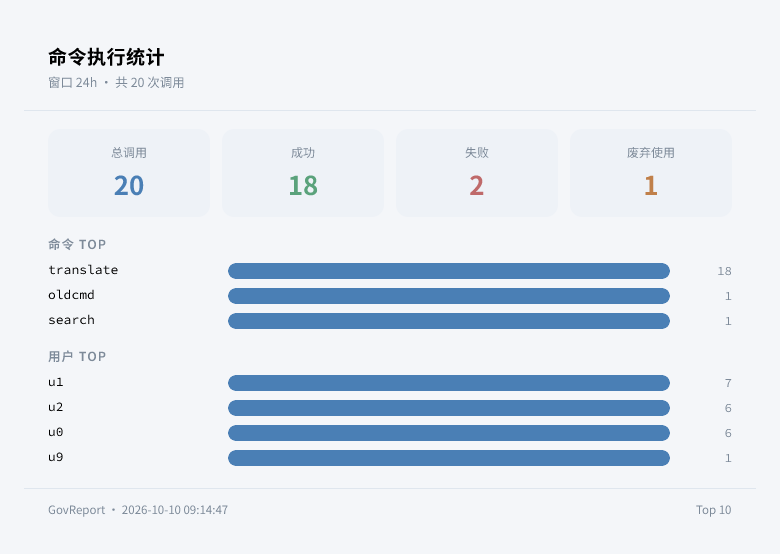
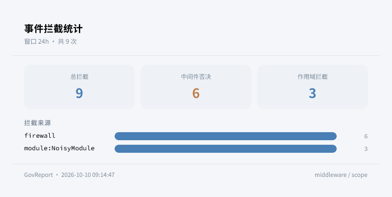
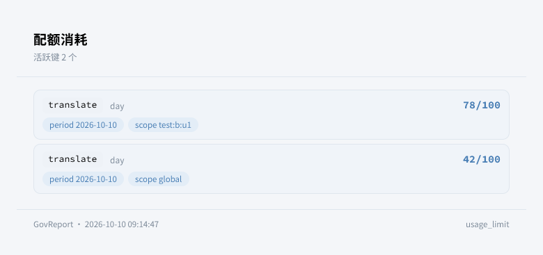
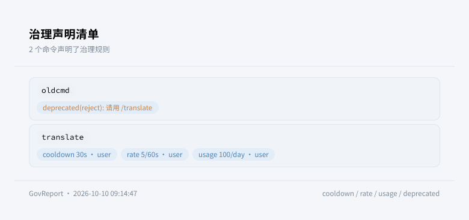

<div align="center">


# ErisPulse GovReport

**治理观测模块 —— 命令执行、事件拦截与配额消耗的统计报表。**

基于 ErisPulse 2.9 命令治理与生命周期事件的观测模块，使用内置 ORM 持久化记录，报表经 Takumi 渲染为卡片。

<p>
  <a href="https://pypi.org/project/ErisPulse-GovReport/"></a>
  <a href="https://pypi.org/project/ErisPulse-GovReport/"></a>
  <a href="./LICENSE"></a>
  <a href="https://github.com/ErisPulse/ErisPulse-GovReport"></a>
  <a href="https://pepy.tech/project/ErisPulse-GovReport"></a>
  <a href="https://github.com/ErisPulse/ErisPulse"></a>
</p>

<p>
  <a href="./README.md">简体中文</a> | <a href="./README.en.md">English</a>
</p>

</div>

---

## 简介

GovReport 是基于 [ErisPulse](https://github.com/ErisPulse/ErisPulse/) 架构开发的治理观测模块：

- 采集 `command.executed` 命令执行记录（成功/失败/废弃）
- 采集 `adapter.event.blocked`（中间件否决）与 `scope.blocked`（作用域拦截）记录
- 读取 `usage_limit` 配额计数（`erispulse.usage` 存储键），对照声明上限展示消耗
- 枚举全部命令的治理声明（cooldown / rate_limit / usage_limit / deprecated）
- 记录用内置 ORM（`Model` / `Field`）持久化，按保留天数自动清理
- 报表经 Takumi 渲染为图片卡片，不可用时降级文本

要求 ErisPulse >= 2.9.0。

---

## 效果展示

| `/gov stats` | `/gov blocked` |
|:---:|:---:|
|  |  |

| `/gov usage` | `/gov list` |
|:---:|:---:|
|  |  |

---


---

## 安装

```bash
epsdk install ErisPulse-GovReport
```

---

## 命令

| 命令 | 说明 |
|------|------|
| `/gov` | 显示用法 |
| `/gov stats [窗口]` | 命令执行统计（调用 Top / 成功率 / 废弃使用），窗口如 `24h`、`7d`，默认 `24h` |
| `/gov user <用户ID> [窗口]` | 单用户调用统计 |
| `/gov blocked [窗口]` | 拦截统计（中间件否决 / 作用域拦截） |
| `/gov usage` | 配额消耗报表（used/limit + 周期 + 作用域） |
| `/gov list [命令]` | 治理声明清单（可按命令名过滤） |
| `/gov purge <天数>` | 清理指定天数之前的记录 |

全部命令需要框架主人权限。

---

## 使用示例

```toml
# 给命令声明治理规则（本模块负责观测这些规则的运行效果）
[ErisPulse.event.command]
prefix = "/"

# Python 侧
# @command("translate", usage_limit="100/day", usage_limit_key="user")
```

```python
from ErisPulse.Core.Event import command

@command("translate", cooldown="30s", rate_limit="5/minute",
         usage_limit="100/day", usage_limit_key="user", help="翻译")
async def translate_handler(event):
    await event.reply("结果")

@command("oldcmd", deprecated="请用 /translate", deprecated_reject=True)
async def old_handler(event):
    ...
```

---

## 配置说明

```toml
[GovReport]
enabled = true                  # 是否启用模块
collect_command_calls = true    # 采集命令执行记录
collect_blocked = true          # 采集拦截记录
retention_days = 30             # 记录保留天数（0 永久保留）
top_n = 10                      # 报表单次展示条目数
render_card = true              # 报表用 Takumi 渲染为卡片
theme = "doodle"                  # 卡片风格 (doodle/editorial)
```

| 配置项 | 类型 | 默认值 | 说明 |
|--------|------|--------|------|
| `enabled` | bool | `true` | 是否启用模块 |
| `collect_command_calls` | bool | `true` | 采集 `command.executed` |
| `collect_blocked` | bool | `true` | 采集中间件否决与作用域拦截 |
| `retention_days` | int | `30` | 保留天数（0 永久，启动与每日清理） |
| `top_n` | int | `10` | 报表单次展示条目数 |
| `render_card` | bool | `true` | 报表渲染为图片卡片 |
| `theme` | str | `doodle` | 卡片风格 (doodle/editorial) |

---

## 注意事项

1. 配额消耗读取自治理系统的存储键（`erispulse.usage`），重启不丢
2. 冷却/限流命中默认静默，不在采集范围内（可用 ErisPulse-Testing 的 DispatchTrace 排查单条命令）
3. 记录写入框架存储后端（SQLite / MySQL / PostgreSQL 由存储配置决定）

---

## 参考链接

- [ErisPulse 主库](https://github.com/ErisPulse/ErisPulse/)
- [命令治理文档](https://github.com/ErisPulse/ErisPulse/tree/main/docs/zh-CN/getting-started/event-handling.md)
- [ORM 文档](https://github.com/ErisPulse/ErisPulse/tree/main/docs/zh-CN/developer-guide/orm.md)
